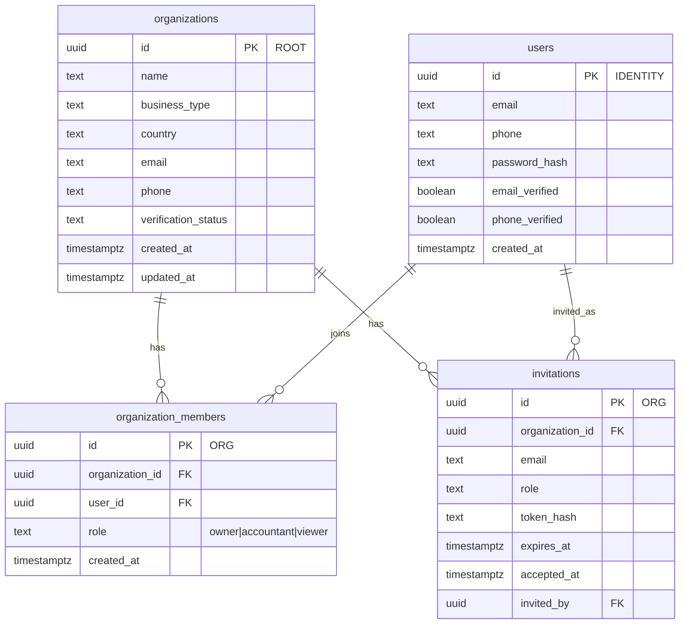
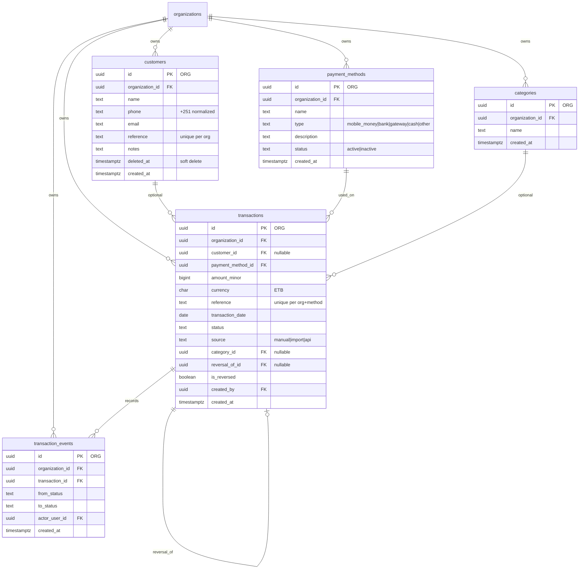
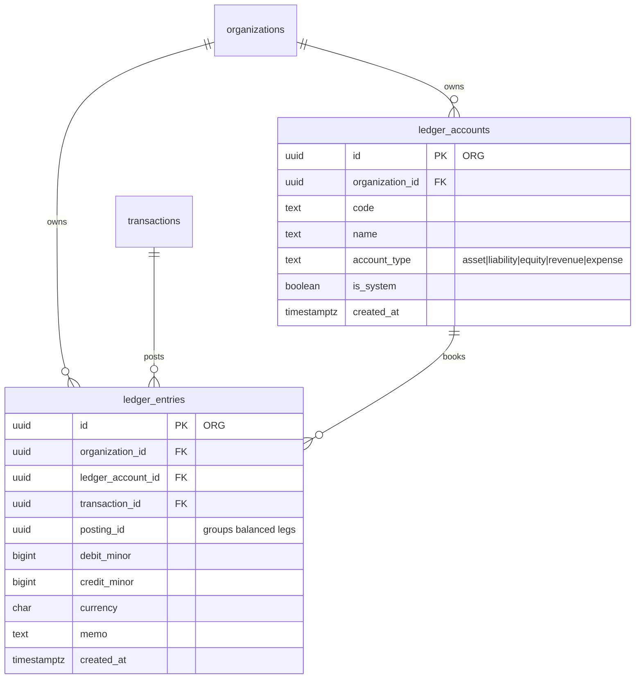
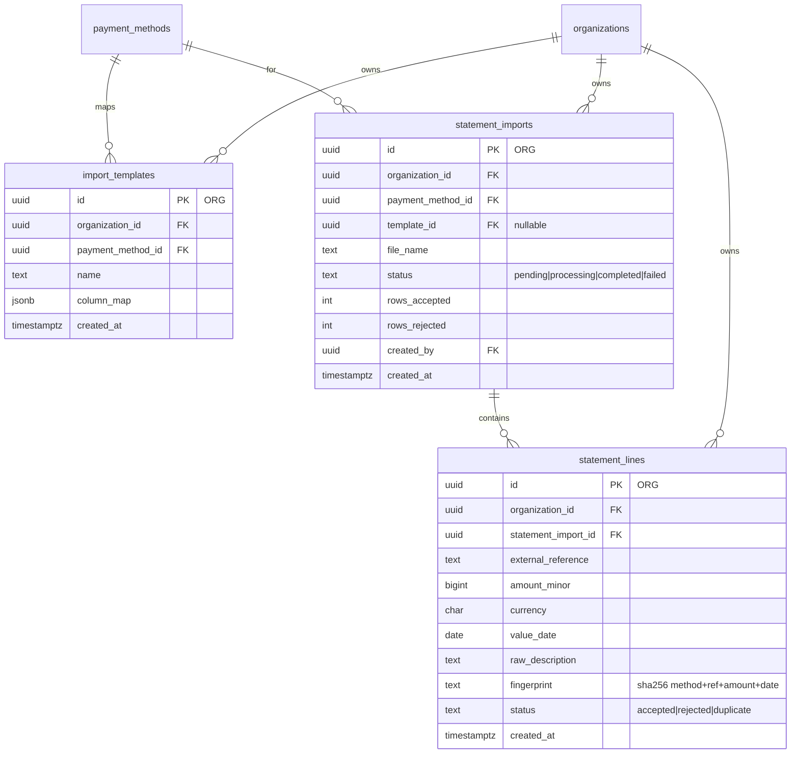
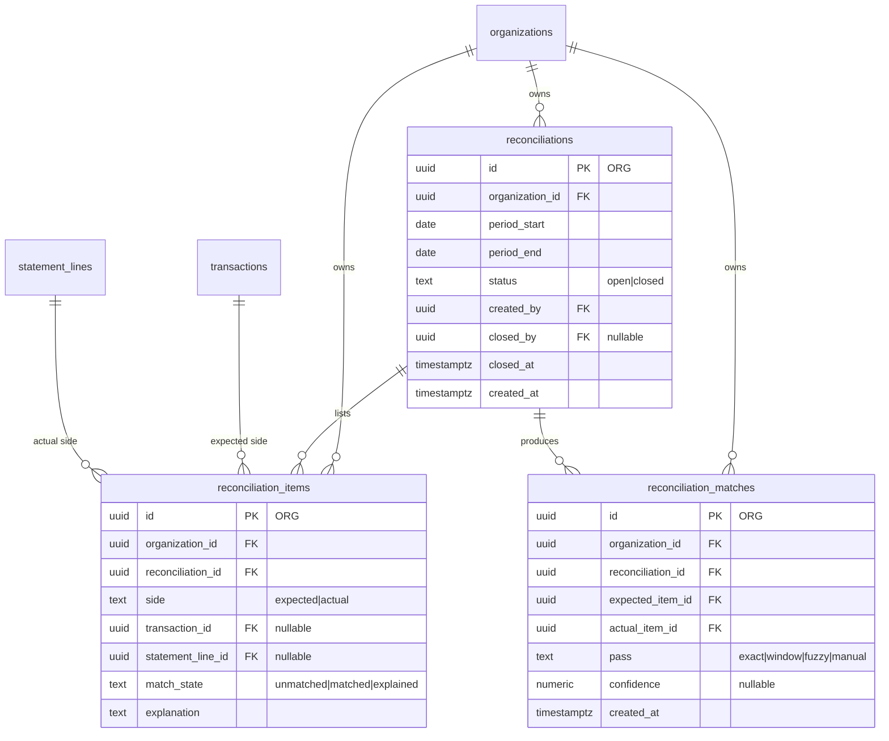
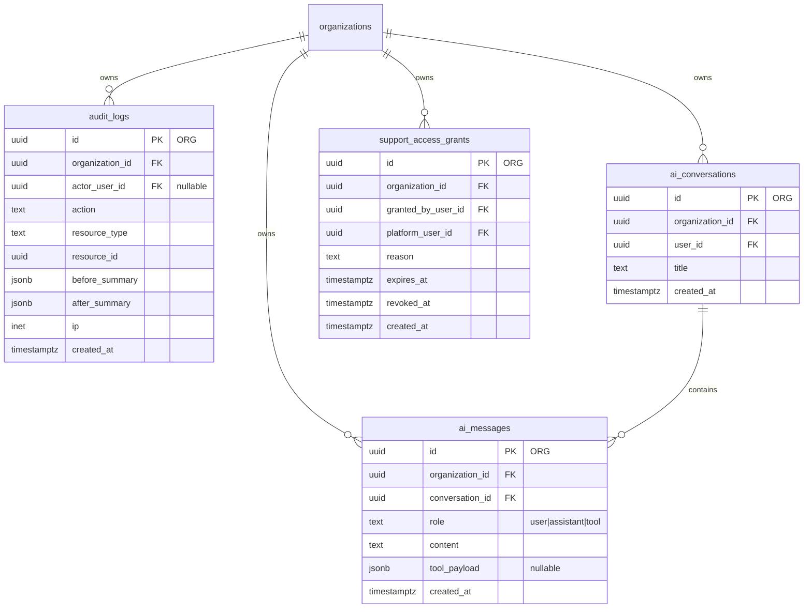
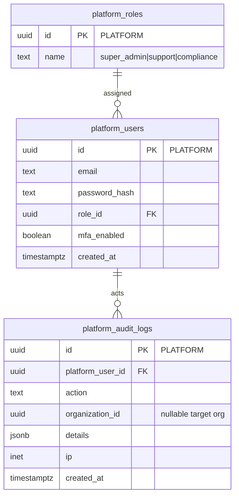

# Database ERD (MVP)

Companion to [RealLedger-PRD-v2.md](RealLedger-PRD-v2.md) §8 and [database-naming-rules.md](database-naming-rules.md).

This is the schema map migrations (Day 8+) must follow. Column lists here are the **core** fields — not every optional attribute.

## Locked decisions (see naming rules for detail)

| Decision | Choice |
| --- | --- |
| Primary keys | `uuid` (`gen_random_uuid()`) |
| Timestamps | `timestamptz`, stored and compared in **UTC** |
| Money | `bigint` minor units + `currency` (`char(3)`), never floats |
| Tenancy | `organization_id uuid NOT NULL` on every tenant-owned table |
| Soft delete | `deleted_at timestamptz NULL` where the PRD requires it (e.g. customers) |

## Tenancy legend

| Mark | Meaning |
| --- | --- |
| **ORG** | Tenant-owned — must include `organization_id` (from the session, never from the client body) |
| **ROOT** | The tenant itself (`organizations`) |
| **IDENTITY** | Login identity; scoped to a company through membership, not a direct `organization_id` |
| **PLATFORM** | RealLedger staff only — separate from tenant tables |

---

## 1. Identity and tenancy

---

## 2. Customers, payment methods, transactions

**Uniques (tenant-safe):**

- `customers (organization_id, reference)` where not soft-deleted
- `transactions (organization_id, payment_method_id, reference)`

---

## 3. Ledger (immutable)

**Invariants (enforced later with constraints + triggers):**

- No `UPDATE` / `DELETE` on `ledger_entries` (and likely `ledger_accounts` once posted against)
- Per `posting_id`: `SUM(debit_minor) = SUM(credit_minor)`
- Exactly one of debit/credit is non-zero per row (or allow both zero only if rejected)

---

## 4. Imports

---

## 5. Reconciliation

---

## 6. Audit, AI, support access

`audit_logs` and ledger tables are **append-only** in product rules.

---

## 7. Platform (separate identity)

Platform staff are **not** rows in `organization_members`. Break-glass access is `support_access_grants` on the tenant side plus `platform_audit_logs`.

---

## Tenant-owned tables (must have `organization_id`)

| Table | Notes |
| --- | --- |
| `organization_members` | Membership edge |
| `invitations` | Pending invites |
| `customers` | Soft-delete |
| `payment_methods` | No provider secrets |
| `transactions` | Money as `amount_minor` |
| `transaction_events` | Status history |
| `ledger_accounts` | Chart of accounts per org |
| `ledger_entries` | Immutable postings |
| `statement_imports` | Upload jobs |
| `statement_lines` | Parsed rows + fingerprint |
| `import_templates` | Column maps |
| `reconciliations` | Period runs |
| `reconciliation_items` | Expected/actual lines |
| `reconciliation_matches` | Links between items |
| `categories` | Optional labels |
| `audit_logs` | Company audit trail |
| `ai_conversations` | Read-only AI sessions |
| `ai_messages` | AI turns / tool results |
| `support_access_grants` | Owner-approved break-glass |

**Not tenant-owned:** `organizations` (root), `users` (identity), `platform_*`.

---

## Out of scope for MVP (named only)

`provider_integrations`, `webhook_events`, `settlements`, `documents`, `ai_insights` — Phase 2+. Do not add to Day 8 migrations unless the PRD changes.
